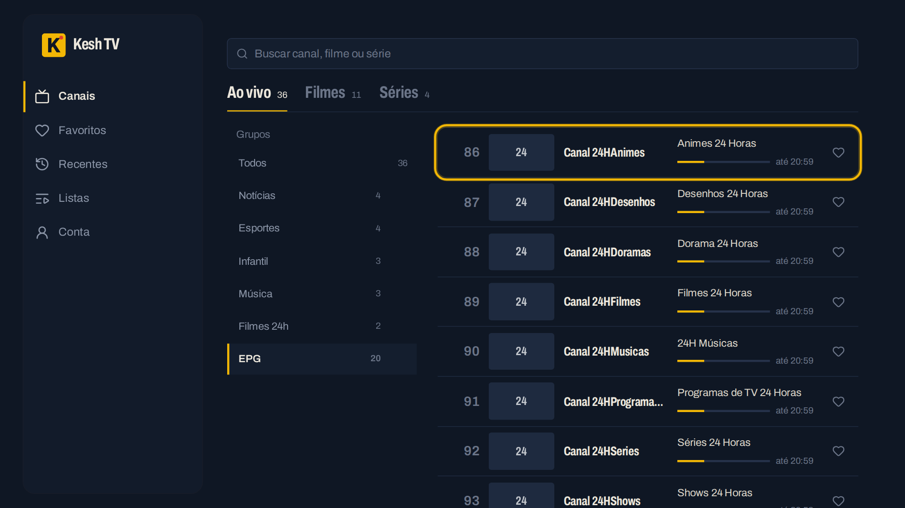

<div align="center">


# Kesh TV

**Leitor de listas IPTV M3U para o navegador** — canais ao vivo, filmes e séries no celular, tablet ou computador, sem instalar nada.

[](https://github.com/dev-kesh2k/kesh-tv/actions/workflows/ci.yml)


</div>

> O app não vem com canais: você usa a sua própria lista M3U (link ou arquivo). Use apenas listas e conteúdos que você tem direito de acessar.

<p align="center">
  
  
</p>

<details>
<summary><b>Mais telas</b></summary>

| Player | Séries | Filmes |
| --- | --- | --- |
|  |  |  |




<sub>Telas com uma lista de demonstração (vídeos de teste livres e imagens genéricas).</sub>
</details>

## O que tem

- **Ao vivo, Filmes e Séries** separados sozinhos, com grupos, busca sem acentos, favoritos, recentes e *continuar de onde parou*.
- **Guia de programação** (o que está no ar agora e a seguir).
- **Listas enormes** por link ou arquivo (testado com 364 mil itens), atualização diária e leitura pela API Xtream quando o provedor bloqueia o M3U.
- **Player** que toca HLS, MPEG-TS e MP4 e converte no servidor o que o navegador não toca (MKV, AVI, HEVC).
- **Em todo lugar**: celular, tablet, computador, **TV** (controle remoto, telas de 32" a 100") e **app Android** em três versões.

## Começar

```bash
git clone https://github.com/dev-kesh2k/kesh-tv.git && cd kesh-tv
cp deploy/docker/.env.example deploy/docker/.env   # troque as senhas
docker compose -f deploy/docker/compose.yml up -d --build
```

Abra **http://localhost:8080**, entre com `SEED_ADMIN_EMAIL` / `SEED_ADMIN_PASSWORD` e adicione sua lista em **Listas**.

## App Android

| Versão | Download |
| --- | --- |
| Padrão (WebView, o mais leve) | [kesh-tv.apk](https://github.com/dev-kesh2k/kesh-tv/releases/latest/download/kesh-tv.apk) |
| Nativo (Kotlin) | [kesh-tv-kotlin.apk](https://github.com/dev-kesh2k/kesh-tv/releases/latest/download/kesh-tv-kotlin.apk) |
| Flutter | [kesh-tv-flutter.apk](https://github.com/dev-kesh2k/kesh-tv/releases/latest/download/kesh-tv-flutter.apk) |

Para gerar o seu: `./build-apk.sh` (pergunta qual das três versões).

## Manual

Tudo em detalhes no **[MANUAL.md](MANUAL.md)**:

- [Recursos](MANUAL.md#recursos) · [Como funciona](MANUAL.md#como-funciona) · [Instalação](MANUAL.md#instalação-rápida-docker)
- [App Android e gerador de APK](MANUAL.md#app-android-celular-e-android-tv) · [Modo TV e controle remoto](MANUAL.md#modo-tv-e-controle-remoto) · [iPhone, iPad e Android pelo navegador](MANUAL.md#iphone-ipad-e-android-pelo-navegador)
- [Listas suportadas](MANUAL.md#listas-m3u-suportadas) · [API](MANUAL.md#api) · [Segurança](MANUAL.md#segurança)
- [Desenvolvimento](MANUAL.md#desenvolvimento) · [Configuração](MANUAL.md#configuração) · [Solução de problemas](MANUAL.md#solução-de-problemas)

## Contribuindo

Toda mudança entra por pull request na `main`. Veja o [guia de contribuição](CONTRIBUTING.md); falhas de segurança em [SECURITY.md](SECURITY.md).

## Licença

[MIT](LICENSE)
