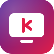
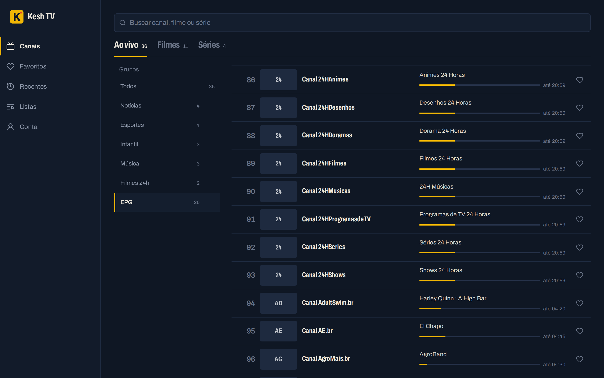
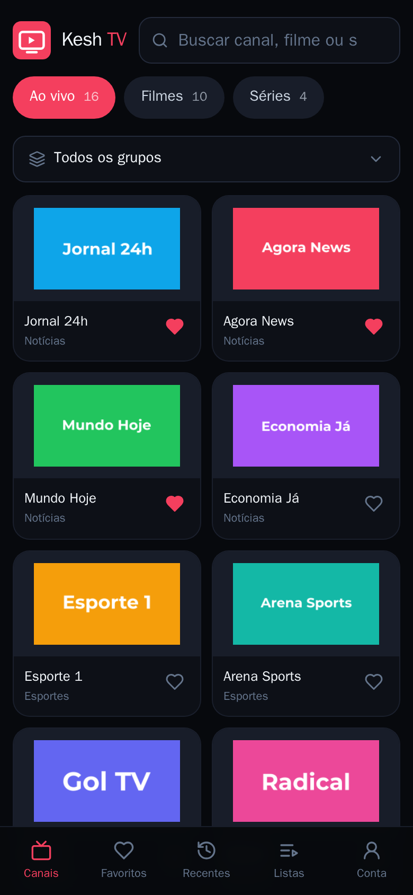
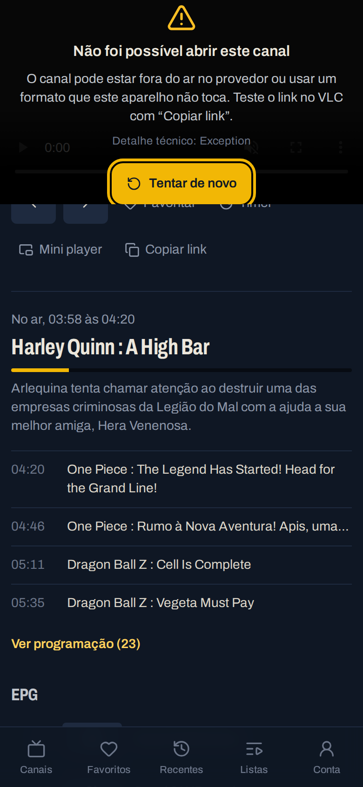
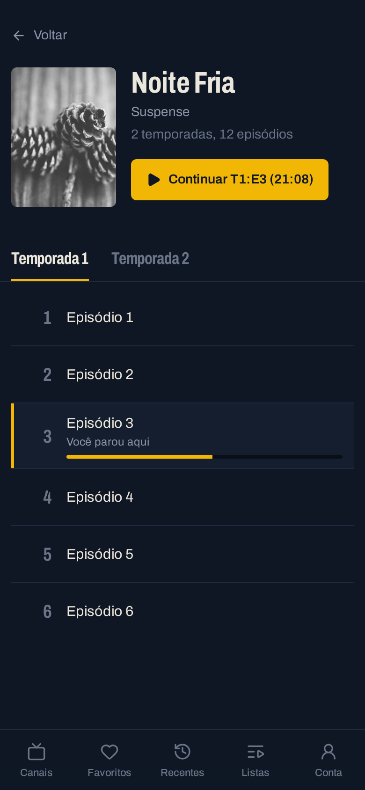
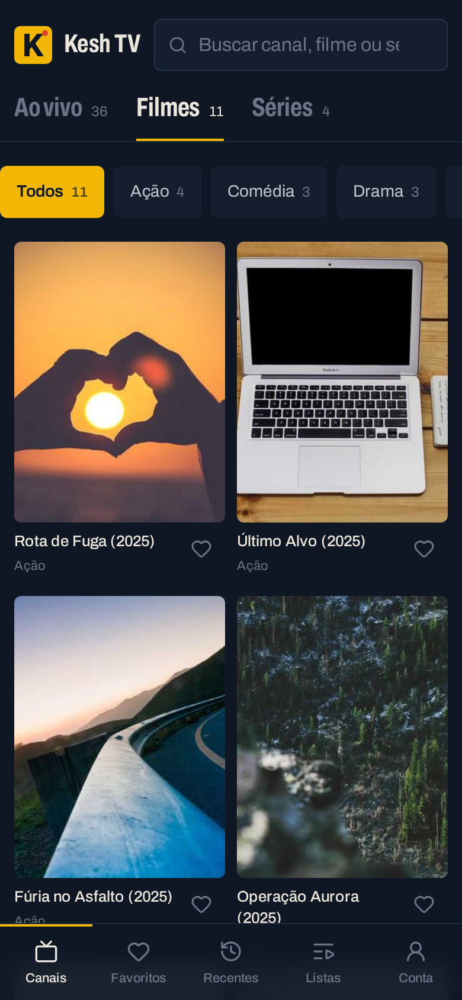
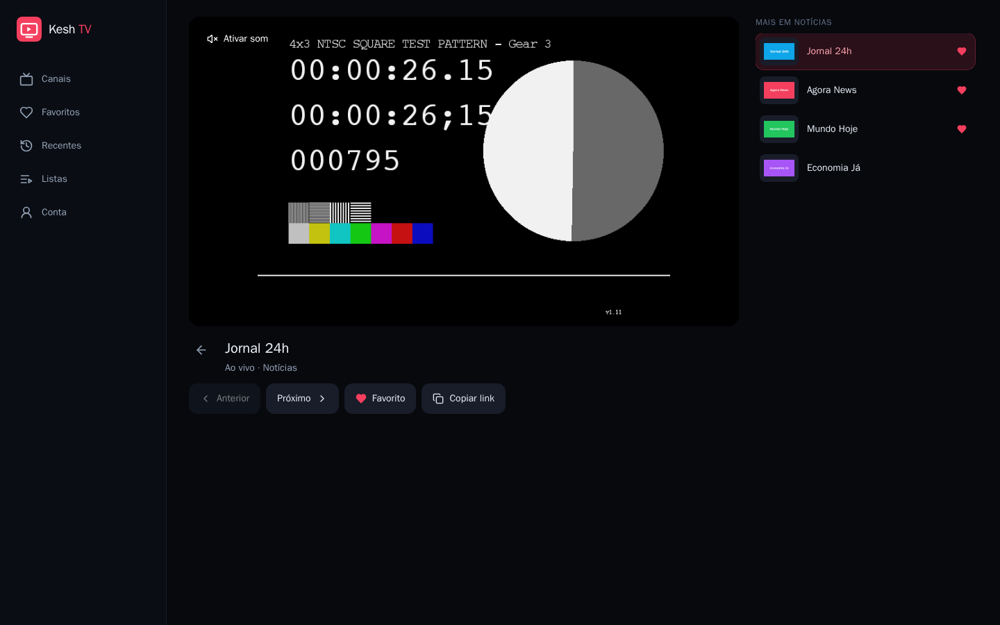
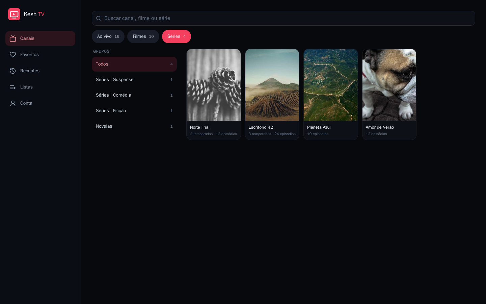

<div align="center">



# Kesh TV

**Leitor de listas IPTV M3U para o navegador** — canais ao vivo, filmes e séries no celular, tablet ou computador, sem instalar nada.

[](https://github.com/dev-kesh2k/kesh-tv/actions/workflows/ci.yml)


</div>

> O app não vem com canais: você usa a sua própria lista M3U (link ou arquivo).

<p align="center">
  
  
</p>

<details>
<summary><b>Mais telas</b></summary>

| Player | Séries | Filmes |
| --- | --- | --- |
|  |  |  |




<sub>Telas com uma lista de demonstração (vídeos de teste livres e imagens genéricas).</sub>
</details>

## Recursos

**Listas e canais**
- Listas M3U por **link** (atualização automática diária) ou **arquivo**; importação em fluxo para listas enormes (testado com 364 mil itens / 95 MB em ~45 s e ~190 MB de memória), com progresso na tela.
- **Ao vivo, Filmes e Séries** separados automaticamente (pelo link no padrão Xtream ou pelo grupo), com grupos (`group-title`) em fileira de botões ou lista lateral, ordem A–Z opcional e **grupos ocultos**.
- **Busca sem acentos** ("acao" acha "Ação") em canais, filmes e séries.
- **Séries agrupadas** por temporada, com *Continuar* e *Próximo episódio*.
- **Favoritos** (com exportar/importar em JSON), **Recentes** com barra de progresso e **continuar de onde parou** em filmes e episódios.
- **Guia de programação (EPG)**: descobre o XMLTV da lista e mostra o programa no ar nos cartões e a programação na tela do canal.

**Player**
- HLS (hls.js ou nativo no iPhone), MPEG-TS/FLV (mpegts.js) e MP4, com troca automática de fonte (link direto → proxy → `.m3u8` do Xtream).
- **Conversão no servidor** (ffmpeg → HLS) para MKV, AVI, HEVC/H.264 10 bits e Opus, com barra própria de avanço.
- Atalhos de teclado e controle remoto, **mini player** (Picture-in-Picture) e **timer para desligar**.

**Plataformas**
- **Celular, tablet e computador** (layout mobile-first, PWA instalável que abre sem internet).
- **TV**: modo TV automático (Android TV, Fire TV, Samsung, LG) com escala para telas de 32" a 100", navegação pelo controle remoto e player em tela cheia.
- **App Android** (celular e Android TV) com gerador de APK.

**Outros**
- Vários usuários (cada um com as próprias listas), resumo em Conta e proxy seguro para streams `http://`, servidores sem CORS ou com `User-Agent`/`Referer` próprios.

## Como funciona

```
 navegador / app Android / TV
            │
            ▼
 frontend  (React + Vite + Tailwind — frontend/)
            │  /api/...
            ▼
 backend   (Express + Prisma — backend/src/)
   ├─ routes.js      rotas da API (login, listas, canais, séries, favoritos, histórico)
   ├─ sync.js        importação das listas em fluxo + atualização automática
   ├─ m3u.js         leitor M3U (atributos, grupos, séries SxxEyy, busca sem acento)
   ├─ epg.js/xmltv.js guia de programação (XMLTV em fluxo, agora/a seguir)
   ├─ stream.js      proxy de streams e logos (reescreve playlists HLS)
   ├─ convert.js     ffmpeg → HLS para formatos que o navegador não toca
   ├─ net.js         rede segura (bloqueio de endereços internos, links assinados)
   └─ auth.js        login (JWT com versão de senha) e limite de tentativas
            │
            ▼
 PostgreSQL  (usuários, listas, canais, programas, favoritos, histórico)
```

- **Listas**: o arquivo é lido linha a linha enquanto baixa e gravado em lotes de 2000 (`INSERT … ON CONFLICT`), então listas de centenas de milhares de itens cabem em pouca memória. Canais que continuam na lista mantêm o id — favoritos e recentes não se perdem.
- **Reprodução**: `GET /channels/:id/play` devolve as fontes em ordem de tentativa; o player passa para a próxima se uma falhar (ou não começar a tempo).
- **Proxy**: streams `http://`, sem CORS ou com cabeçalhos próprios passam por `/api/stream` com **links assinados** (HMAC + validade), porque `<video>` e `` não mandam o token de login.
- **Conversão**: arquivos que o navegador não toca viram HLS na hora; H.264 de 8 bits só é reempacotado (quase sem CPU), o resto vira H.264. O ffmpeg pausa quando está ~3 min à frente do que está sendo assistido.

## Instalação rápida (Docker)

Banco, API (com ffmpeg) e frontend com um comando:

```bash
git clone https://github.com/dev-kesh2k/kesh-tv.git && cd kesh-tv
cp deploy/docker/.env.example deploy/docker/.env   # troque as senhas
docker compose -f deploy/docker/compose.yml up -d --build
```

Abra **http://localhost:8080**, entre com `SEED_ADMIN_EMAIL` / `SEED_ADMIN_PASSWORD` e adicione sua lista em **Listas**.

## App Android (celular e Android TV)

[**⬇️ Baixar kesh-tv.apk**](https://github.com/dev-kesh2k/kesh-tv/releases/latest/download/kesh-tv.apk) — funciona em celulares e em Android TV (TV Box, Fire TV, Chromecast com Google TV), com ícone na tela inicial da TV, navegação pelo controle remoto e escala automática para TVs de 32" a 100".

### Gerar o APK

- **Pelo GitHub:** Actions → *APK Android* → *Run workflow* (ou crie uma tag `v1.2.3`). Publica uma Release com `kesh-tv.apk`. A assinatura usa os segredos `KESH_KEYSTORE_B64` e `KESH_KEYSTORE_PASSWORD`.
- **Na sua máquina (só precisa de Docker):**

  ```bash
  android/build-apk.sh 1.2.0                                   # aponta para o servidor padrão
  android/build-apk.sh 1.2.0 https://meu-servidor/kesh-tv/     # seu próprio servidor
  ```

  Na primeira vez cria a chave de assinatura em `android/keystore/` (fora do git). **Guarde uma cópia**: sem a mesma chave as próximas versões não instalam por cima.

O app é um WebView que abre o Kesh TV publicado: atualizações do site chegam sem reinstalar. Ele informa ao site que está numa TV (modo TV automático) e mantém a tela acesa durante o vídeo.

## Modo TV e controle remoto

O modo TV liga sozinho em Android TV, Fire TV, Samsung (Tizen), LG (webOS) e no app Android numa TV. Dá para forçar em **Conta → Modo TV** (Automático / Ligado / Desligado) ou com `?tv=1` / `?tv=0` no endereço.

- **Escala para qualquer TV (32" a 100", 720p a 4K):** a página usa um *viewport* de 1280 px e a TV amplia até a tela real — o app ocupa sempre a mesma fração da tela.
- **Margem de segurança** nas bordas (overscan), letras ~15% maiores e grade com 4 colunas.
- **Foco inicial** no primeiro canal de cada tela; destaque rosa no item focado.
- **Player em tela cheia** com painel de informações (canal, AO VIVO, programa atual/próximo) que some em 5 s.

| Tecla | Nas listas | No player |
| --- | --- | --- |
| ↑ ↓ ← → | move o destaque para o item mais próximo | ↑↓ trocam de canal/episódio · ←→ voltam/avançam 10 s |
| OK / Enter | abre | pausa/retoma (o 1º OK liga o som se começou mudo) |
| Voltar / Backspace | tela anterior (não sai do app na 1ª tela) | sai do player |
| Play, Pause, Stop | — | controlam o vídeo |
| Espaço / K · F · M | — | pausa · tela cheia · mudo (teclado) |
| Canal + / Canal − | — | trocam de canal |

## iPhone, iPad e Android pelo navegador

- **iPhone/iPad:** Safari → Compartilhar → *Adicionar à Tela de Início* (abre em tela cheia, como app).
- **Android:** Chrome → *Instalar app*; segurar o ícone mostra atalhos para Favoritos, Recentes e Filmes.
- O app guarda telas e arquivos (service worker) e abre sem internet; sem conexão mostra "Sem conexão" e reconecta sozinho.

## Listas M3U suportadas

- Formato estendido (`#EXTM3U`/`#EXTINF`) com `tvg-id`, `tvg-name`, `tvg-logo`, `group-title`, `#EXTGRP`; também lista sem `#EXTM3U` e quebras de linha do Windows.
- Cabeçalhos por canal: `#EXTVLCOPT:http-user-agent=…`, `#EXTVLCOPT:http-referrer=…` e o formato Kodi `url|User-Agent=…&Referer=…`.
- Guia de programação: `url-tvg` / `x-tvg-url` no `#EXTM3U` ou, em servidores Xtream (`get.php?username=…&password=…`), o `xmltv.php` correspondente.
- **Tipo do item** (nesta ordem): `/movie/` → filme, `/series/` → série, `/live/` ou `.ts`/`.m3u8` → ao vivo; sem pista no link, decide pelo grupo ("Séries", "Novelas", "Filmes", "VOD"…).
- **Séries**: o nome antes de `S01E02` / `S1 E2` vira a série; episódios são ordenados por temporada e número.
- URLs repetidas são ignoradas; limites: 300 MB e 15 min por download, até 1 milhão de itens, 20 listas por usuário, upload de arquivo até 95 MB (use o link para listas maiores).

## Rodando localmente (desenvolvimento)

Requisitos: Node 22, PostgreSQL e ffmpeg (para a conversão).

```bash
# backend
cd backend
cp .env.example .env          # ajuste DATABASE_URL, JWT_SECRET e a senha do admin
npm install
npx prisma migrate deploy
npm run db:seed               # cria o admin (SEED_ADMIN_EMAIL / SEED_ADMIN_PASSWORD)
npm start                     # http://localhost:3000/api/health

# frontend (outro terminal)
cd frontend
npm install
npm run dev
```

Com Docker, o `backend/Dockerfile` já traz Node + ffmpeg.

## Variáveis do backend

| Variável | Para quê |
| --- | --- |
| `DATABASE_URL` | PostgreSQL |
| `JWT_SECRET` | assinatura do login e dos links do proxy |
| `PUBLIC_PATH` | prefixo quando o app roda num subcaminho (ex.: `/kesh-tv`) |
| `SEED_ADMIN_*` | admin criado no primeiro start |
| `NODE_OPTIONS` | limite de memória (padrão `--max-old-space-size=256`) |

## Observações

- A conversão guarda as sessões na memória do processo: rode o backend com **1 réplica**.
- Limites: 300 MB / 15 min por lista; até 4 conversões simultâneas (2 recodificando vídeo).
- Use apenas listas e conteúdos que você tem direito de acessar.

## Como as mudanças entram

Toda mudança entra por **pull request** na `main` (o Central Apps Hub abre e mescla o PR); o GitHub Actions publica em produção quando o PR entra na `main`.

## Contribuindo

Veja o [guia de contribuição](CONTRIBUTING.md). Falhas de segurança: [SECURITY.md](SECURITY.md).

## Licença

[MIT](LICENSE)
